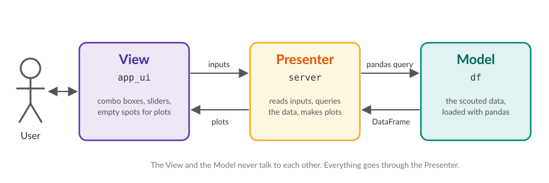
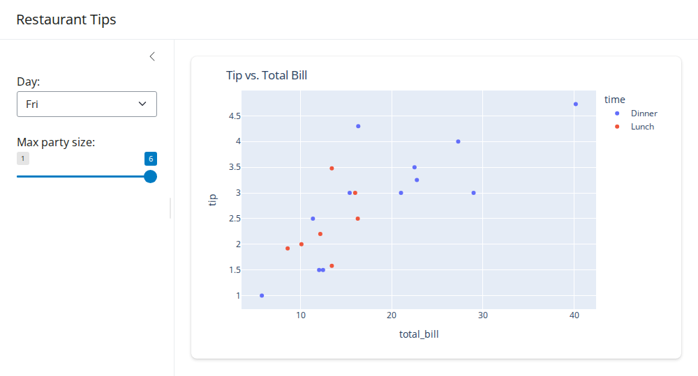

Intro to Shiny Codelab
======================

`Shiny for Python <https://shiny.posit.co/py/>`_ is a framework for making quick interactive web apps entirely in python.

Shiny has two ways of writing apps, **Shiny Core** and **Shiny Express**. We use **Shiny Core**. Shiny's website
has a toggle on most of its examples to switch between the two, so make sure it is set to *Core* when you copy
from there. You can tell a Core app because it ends with :code:`app = App(app_ui, server)`.

Model-View-Presenter
--------------------

A big app gets messy fast unless you split it up. Shiny splits every app into pieces that follow a design pattern
called **Model-View-Presenter** (MVP):

          sends pandas queries to the Model and gets DataFrames back.

* **Model**: the data. For us, that is a pandas :code:`DataFrame` of scouted data. The model doesn't know or care
  that there is an app.
* **View**: what the user sees, which Shiny calls :code:`app_ui`. It lays out the combo boxes, sliders, tabs and the
  empty spots where plots will go. The view doesn't do any math, and it doesn't know the data exists.
* **Presenter**: the glue, which Shiny calls :code:`server`. It reads what the user picked in the view, queries the
  model, makes plots out of the result and hands them back to the view.

The Example App
---------------

Like the plotly lab, we'll use the **tips** dataset for the examples on this page. Each row is one meal at a
restaurant. This whole app is one file, :code:`app.py`:

.. code-block:: python

    import plotly.express as px
    from shiny import App, ui
    from shinywidgets import output_widget, render_widget

    # Model
    df = px.data.tips()

    # View
    app_ui = ui.page_sidebar(
        ui.sidebar(
            ui.input_select("day", "Day:", choices=["Thur", "Fri", "Sat", "Sun"]),
            ui.input_slider("party_size", "Max party size:", min=1, max=6, value=6),
        ),
        ui.card(output_widget("tip_plot")),
        title="Restaurant Tips",
    )

    # Presenter
    def server(input, output, session):
        def get_filtered_meals():
            day_df = df[df["day"] == input.day()]
            return day_df[day_df["size"] <= input.party_size()]

        @render_widget
        def tip_plot():
            fig = px.scatter(get_filtered_meals(), x="total_bill", y="tip", color="time", title="Tip vs. Total Bill")
            return fig

    app = App(app_ui, server)

Run it with :code:`shiny run --reload app.py` and open http://127.0.0.1:8000 in your browser:

Pick a different day or drag the slider and the plot redraws itself. Let's break down how.

The Model
_________

.. code-block:: python

    df = px.data.tips()

For this example, we are using Plotly's tips dataset. For us the model would include scouted data, match schedule, team list, etc.

The View
________

.. code-block:: python

    app_ui = ui.page_sidebar(
        ui.sidebar(
            ui.input_select("day", "Day:", choices=["Thur", "Fri", "Sat", "Sun"]),
            ui.input_slider("party_size", "Max party size:", min=1, max=6, value=6),
        ),
        ui.card(output_widget("tip_plot")),
        title="Restaurant Tips",
    )

The view is built by nesting function calls inside each other. :code:`ui.page_sidebar` makes a page with a sidebar,
:code:`ui.sidebar` holds the controls, and :code:`ui.card` draws a box around the plot.

There are two kinds of components in here:

* **Inputs** like :code:`ui.input_select` and :code:`ui.input_slider`. The first argument is always the input's
  **id** (:code:`"day"`), and the second is the label the user sees (:code:`"Day:"`).
* **Outputs** like :code:`output_widget("tip_plot")`. An output is an empty placeholder. It only has an **id**,
  because the view has no idea what is going to go in it.

The Presenter
_____________

.. code-block:: python

    def server(input, output, session):
        def get_filtered_meals():
            day_df = df[df["day"] == input.day()]
            return day_df[day_df["size"] <= input.party_size()]

        @render_widget
        def tip_plot():
            fig = px.scatter(get_filtered_meals(), x="total_bill", y="tip", color="time", title="Tip vs. Total Bill")
            return fig

The server function reads the inputs, filters the dataframe, and builds the plot. :code:`get_filtered_meals` is a
plain helper function. :code:`tip_plot` has the special :code:`@render_widget` decorator, which tells Shiny "this
function fills in an output".

Connecting the UI and Server
----------------------------

Notice that the view never says "call :code:`tip_plot()`", and the server never says "put this in the card". Shiny
connects them by matching the id strings to names in the server:

.. raw:: html
    :file: figures/connect.html

.. warning::

    This part is all witchcraft and black magic. The library is very smart and does a lot of things behind
    the scenes to auto-magically know how to link these things up. You don't need to know how it works, it's
    just how it's done.

The rules:

* **Input ids** turn into functions on :code:`input`. :code:`ui.input_select("day", ...)` means the server can call
  :code:`input.day()` to get whatever is currently selected. Don't forget the :code:`()`. :code:`input.day` without
  parentheses is the function itself, not the value.
* **Output ids** must match a function name in the server that has a :code:`@render_...` decorator.
  :code:`output_widget("tip_plot")` gets filled in by :code:`def tip_plot()`. If the names don't match *exactly*
  (capitalization and underscores count), the output just stays blank. There's no error.
* **Helper functions** without a decorator, like :code:`get_filtered_meals`, can read inputs too. They just can't
  fill in an output on their own; a decorated function has to call them.

Reactivity
__________

Shiny keeps track of which inputs each output read the last time it ran. :code:`tip_plot` called
:code:`get_filtered_meals()`, which read :code:`input.day()` and :code:`input.party_size()`, so whenever either of
those changes Shiny re-runs :code:`tip_plot` and swaps in the new plot. You never write "when the combo box changes,
redraw the plot". Reading the input is enough.

Cheat Sheet
-----------

These are the components you'll use most. The `component gallery <https://shiny.posit.co/py/components/>`_ has
every one with live examples (remember to toggle to *Core*).

.. list-table::
    :header-rows: 1
    :widths: 40 60

    * - Component
      - What it does
    * - :code:`ui.input_select(id, label, choices)`
      - Combo box. :code:`input.<id>()` returns the selected choice **as a string**.
    * - :code:`ui.input_slider(id, label, min, max, value)`
      - Slider. Returns a number.
    * - :code:`ui.input_radio_buttons(id, label, choices)`
      - Radio buttons. Returns the selected choice as a string.
    * - :code:`ui.input_checkbox(id, label)`
      - Checkbox. Returns :code:`True` or :code:`False`.
    * - :code:`output_widget(id)` + :code:`@render_widget`
      - A plotly graph. The function returns a :code:`fig`. These come from the :code:`shinywidgets` package.
    * - :code:`ui.output_text(id)` + :code:`@render.text`
      - Plain text. The function returns a string.
    * - :code:`ui.page_navbar(...)` + :code:`ui.nav_panel(title, ...)`
      - A page with tabs across the top.
    * - :code:`ui.layout_sidebar(ui.sidebar(...), ...)`
      - A sidebar for controls next to the main content.
    * - :code:`ui.card(...)`
      - A box around something, usually a plot.

Troubleshooting
---------------

* **A plot is blank**: the id in :code:`output_widget("...")` doesn't match the function name, or you forgot the
  :code:`@render_widget` decorator. Also check the terminal you ran :code:`shiny run` from, because python errors in
  the server show up there.
* **The plot is empty but has axes**: your query returned zero rows. A combo box always returns a *string*, so
  :code:`scouted_data["match_number"] == input.match_select()` compares a number to a string and never matches. Convert it
  with :code:`int(...)`.
* **"Address already in use"**: you already have the app running in another terminal. Stop it with
  :code:`Ctrl+C`.

Shiny Codelab
-------------

Time to build the start of a scouting app with real data. Open :code:`source/CL5_shiny_codelab.py`. It is split
into the same three pieces:

* **Model**: the scouted data from :code:`source/data/scouted_data.csv`, already loaded as :code:`scouted_data`.
* **View**: already laid out for you, with two tabs, **Match Preview** and **Team Overview**. Each tab has a combo
  box in the sidebar and some empty plot cards.
* **Presenter**: mostly empty. It has a couple of helper functions and :code:`# TODO: Step N` comments where your
  code goes.

The plotting code for each step is given below so you can copy and paste it. Your job is to hook it up to the view.

Step 0: Run the App
___________________

From the root of the repository, run:

.. code-block:: bash

    shiny run --reload source/CL5_shiny_codelab.py

Open http://127.0.0.1:8000 and click between the two tabs. The combo boxes work, but every card is blank because
the server doesn't fill anything in yet. Leave the app running. With :code:`--reload`, it restarts every time you
save the file.

.. warning::

    The auto-reload can be sketchy on Windows computers. Sometimes it gets stuck and you have to kill python from
    the task manager, so Windows users might not want to include that flag.

Match Preview
_____________

Step 1: Read the Match Number
^^^^^^^^^^^^^^^^^^^^^^^^^^^^^

Find :code:`get_teams_in_selected_match` in the server. The pandas query is already written: it finds every team
that played in :code:`match_number` and returns *all* of the scouted data for those teams, so we can see how they
have done so far.

Replace :code:`None` so that :code:`match_number` holds the match picked in the :code:`"match_select"` combo box.
Look at the Troubleshooting section above for a hint about combo boxes and strings.

Step 2: Average Points
^^^^^^^^^^^^^^^^^^^^^^

The view has an :code:`output_widget("match_average_points")`, but nothing in the server fills it in. At
:code:`# TODO: Step 2`, write a function with the **right decorator** and the **right name**, and use this as its
body:

.. code-block:: python

    avg_data = get_teams_in_selected_match().groupby("team_key")[["totalAutoPoints", "totalTeleopPoints", "totalEndgamePoints"]].mean().reset_index()
    fig = px.bar(avg_data, x="team_key", y=["totalAutoPoints", "totalTeleopPoints", "totalEndgamePoints"], title="Average Points per Match")
    return fig

Save the file and you should see a stacked bar chart of the six teams. Change the match number and it should
change too.

Step 3: Contributed Points
^^^^^^^^^^^^^^^^^^^^^^^^^^

Same idea for the second card, :code:`output_widget("match_contributed_points")`:

.. code-block:: python

    fig = px.box(get_teams_in_selected_match(), x="team_key", y="contributedPoints", points="all", title="Contributed Points per Match")
    return fig

Step 4: Your Own Output
^^^^^^^^^^^^^^^^^^^^^^^

This time there's no card in the view yet, so you need to add **both halves** of the connection:

#. In the view, at :code:`# TODO: Step 4`, add a card with an :code:`output_widget` whose id is
   :code:`"match_coral_vs_algae"`. Look at the two cards above it for the syntax.
#. In the server, at :code:`# TODO: Step 4`, add the matching function with this body:

.. code-block:: python

    avg_data = get_teams_in_selected_match().groupby("team_key").mean(numeric_only=True).reset_index()
    fig = px.scatter(avg_data, x="totalTeleopCoral", y="totalTeleopAlgae", text="team_key", title="Average Teleop Coral vs. Algae")
    fig.update_traces(textposition="top center")
    return fig

Team Overview
_____________

Step 5: Read the Team
^^^^^^^^^^^^^^^^^^^^^

Find :code:`get_selected_team_data` in the server and replace :code:`None` so that :code:`team` holds the team
picked in the :code:`"team_select"` combo box. Team keys like :code:`"frc3504"` are already strings, so this one
doesn't need converting.

Step 6: Points Over Time
^^^^^^^^^^^^^^^^^^^^^^^^

Fill in :code:`output_widget("team_points_over_time")`:

.. code-block:: python

    team_data = get_selected_team_data().sort_values("match_number")
    fig = px.area(team_data, x="match_number", y=["totalAutoPoints", "totalTeleopPoints", "totalEndgamePoints"], markers=True, title="Points per Match")
    return fig

Step 7: Climb Results
^^^^^^^^^^^^^^^^^^^^^

Like Step 4, add both halves yourself: a card in the view with the id :code:`"team_climb_results"`, and the matching
server function:

.. code-block:: python

    fig = px.pie(get_selected_team_data(), names="bargeStatus", title="Endgame Climb Results")
    return fig

Step 8: Challenge
^^^^^^^^^^^^^^^^^

No code given for this one. Add a second combo box to the **Match Preview** sidebar that lets the user pick which
column the Step 3 box plot shows, for example :code:`"contributedPoints"`, :code:`"totalAutoPoints"`,
:code:`"totalTeleopPoints"` or :code:`"totalEndgamePoints"`. Then change the box plot to use whatever is selected
instead of always using :code:`"contributedPoints"`.
